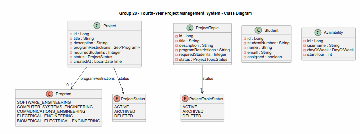

# Fourth-Year Project Management System

A web-based project management platform designed to support the fourth-year engineering project process at Carleton University.

The system will provide a centralized platform for students, professors, and project coordinators to manage project topics, student applications, oral presentations, and final report submissions.

## Links

| | |
|---|---|
| **Live App (Azure)** | https://4th-year-project-management-system-fah0egb5fwewbbb6.mexicocentral-01.azurewebsites.net |
| **Kanban Board** | https://github.com/users/GabrielleFarahexe/projects/1 |

## Demo Logins
| Username | Password | Role | Lands on |
|---|---|---|---|
| student | student123 | Student | /student/dashboard |
| professor | professor123 | Professor | /professor |
| coordinator | coordinator123 | Coordinator | /coordinator/dashboard |
| admin | group20demo | All roles | /about (can open every page) |

Opening the site goes to the login page. Each role only sees its own pages; `/about` explains the system and links to every role's pages.

## Current Status (Milestone 2)
**Completed**
- Role-based login: student, professor and coordinator each have their own pages
- Student dashboard, Browse Projects with keyword search and program filter
- Professor dashboard and Add Project form with validation
- Coordinator dashboard with student counts
- Presentation availability for students and professors
- One shared `Project` entity, so projects professors add show up for students
- CI on every PR, 2 required approvals to merge, deployed to Azure

**In progress**
- Students apply to a project with a capacity limit (#22)
- Restyling all pages to match the UI mockup (#28)

## Next Sprint Plan (Sprint 3 – Final Demo, Dec 10)
| Feature | Owner |
|---|---|
| Students apply to a project, with capacity limits, and see it in "My project" | Gabrielle |
| Professors manage projects (edit, archive, delete) and accept or reject applications | TBD |
| Coordinator sees students without a project and sends reminder emails | TBD |
| Presentation room allocation and scheduling using submitted availability | TBD |
| Final report submission with a coordinator-set deadline | TBD |
| Store users in the database instead of hard-coded logins | TBD |
| Restyle all pages to match the UI mockup | Everyone (own role's pages) |

## Team Members

| Name | GitHub Username |
|---|---|
| Gabrielle Farah | [@GabrielleFarahexe](https://github.com/GabrielleFarahexe) |
| Jumana Mahmoud | [@JumanaAmrM](https://github.com/JumanaAmrM) |
| Matthew Gibeault | [@EnderAres183](https://github.com/EnderAres183) |
| Jordan Grewal | [@gurpinderjgrewal](https://github.com/gurpinderjgrewal) |
| Aryan Singh | [@AryanK-Singh](https://github.com/AryanK-Singh) |

## UML Class Diagram



## Project Overview

The Fourth-Year Project Management System aims to simplify and organize the administration of fourth-year engineering projects.

The application will support three main user roles:

- **Students:** Browse available project topics, apply to projects, provide presentation availability, and submit final reports.
- **Professors:** Create, manage, archive, and delete project topics.
- **Project Coordinators:** Monitor student project selections, send reminders, coordinate oral presentations, and manage submission deadlines.

## Planned Features

- Project topic creation and management.
- Project descriptions, program restrictions, and student capacity.
- Student project browsing and application.
- Application capacity enforcement.
- Identification of students without assigned projects.
- Coordinator reminders for students without projects.
- Oral presentation availability management.
- Presentation room allocation and scheduling.
- Online final report submissions.
- Coordinator-defined submission deadlines and deadline enforcement.

## Technology Stack

The project is being developed using:

| Technology | Purpose |
|---|---|
| Java | Application development |
| Spring Boot | Application framework |
| Spring MVC | Web application architecture |
| Spring Data JPA | Database interaction |
| Maven | Dependency management and build automation |
| Thymeleaf | Server-side HTML rendering |
| H2 | Temporary development database |
| PostgreSQL | Planned production database |
| GitHub | Version control and collaboration |
| GitHub Actions | Continuous integration |
| Microsoft Azure | Application hosting |

*The technology stack and deployment configuration are subject to change during development.*

## Getting Started

### Prerequisites

- Java JDK compatible with the project's Spring Boot version.
- Git.
- Maven (optional, as the repository includes the Maven Wrapper).

### Clone the Repository

```bash
git clone https://github.com/GabrielleFarahexe/SYSC-4806-4th-Year-Project-Management-System.git
cd SYSC-4806-4th-Year-Project-Management-System
```

### Build the Application

Windows:

```powershell
.\mvnw.cmd clean verify
```

macOS/Linux:

```bash
./mvnw clean verify
```

### Run the Application

Windows:

```powershell
.\mvnw.cmd spring-boot:run
```

macOS/Linux:

```bash
./mvnw spring-boot:run
```

Once running, access the application at:

http://localhost:8080

## Development Process

Development will be organized into three two-week sprints.

Each sprint will focus on implementing and testing a portion of the system's functionality.

## Repository Structure

```text
SYSC-4806-4th-Year-Project-Management-System/
│
├── .mvn/
├── src/
│   ├── main/
│   │   ├── java/
│   │   └── resources/
│   └── test/
│
├── pom.xml
├── mvnw
├── mvnw.cmd
├── README.md
└── .gitignore
```

## Course Project

**Course:** SYSC 4806 – Software Engineering Project

**Institution:** Carleton University

**Project:** Fourth-Year Project Management System
